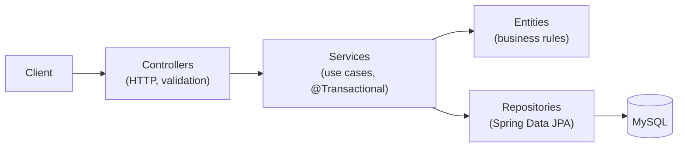
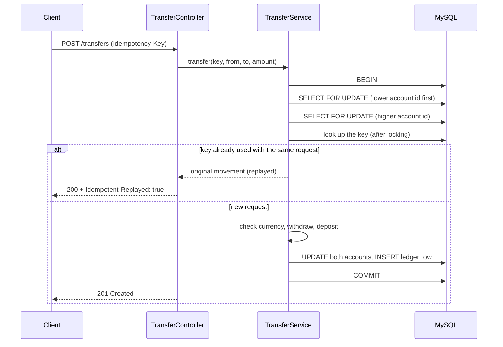
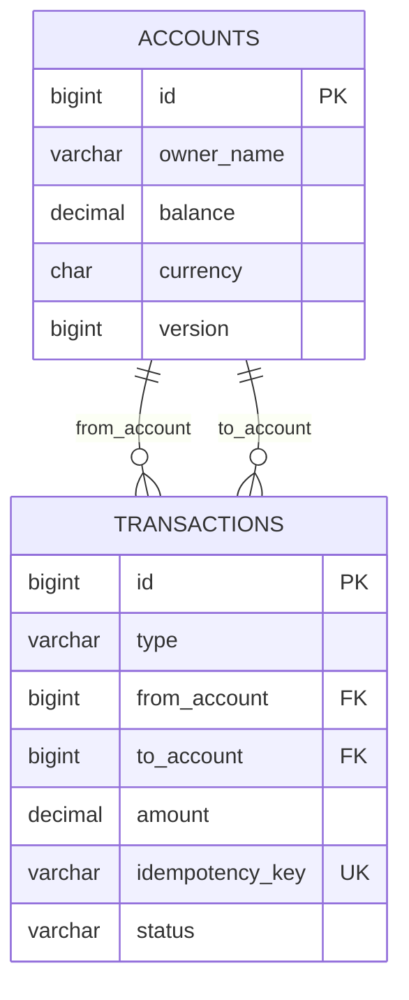

# bank-api


A transactional banking REST API built with **Java 21, Spring Boot and MySQL**: accounts, deposits, **idempotent
transfers** and a **paginated movement history**, with concurrency safety that is **proven by tests against a real
database**, not just claimed.

## Why this project

Most CRUD demos stop at "it works on my machine". This one focuses on what matters in financial systems:

- **Atomic money movements** (ACID): a transfer either happens completely or not at all.
- **Concurrency correctness**: row locking acquired in a fixed order, so crossed transfers (A→B and B→A at
  the same time) cannot deadlock and balances are never lost or overdrawn.
- **Idempotent transfers**: a client can safely retry a request; the money moves once.
- **Versioned schema** (Flyway) with database-level guards (`CHECK`, `UNIQUE`, foreign keys), not only application checks.
- **Tests against real MySQL** (Testcontainers), including multi-threaded tests with exact assertions.

## Features

- Create and query accounts (owner and ISO currency code; balance starts at 0).
- Deposits, recorded in a ledger table.
- Transfers between two accounts of the same currency, optionally idempotent through the `Idempotency-Key` header.
- Paginated history per account (origin or destination), newest first.
- Input validation and uniform error responses ([RFC 7807](https://www.rfc-editor.org/rfc/rfc7807) `ProblemDetail`).
- Interactive API documentation (Swagger UI) and a health endpoint.
- Money handled with `BigDecimal` / `DECIMAL(19,4)`; never floating point.

## What the tests prove

65 automated tests (26 unit, 20 web-layer, 19 integration against MySQL). The concurrency tests are the
interesting part:

| Scenario | Guarantee verified |
|---|---|
| 100 crossed transfers (A→B and B→A) run in parallel by 16 threads | No deadlock; final balances are exact (e.g. 9,800 and 10,200) |
| 100 concurrent transfers of 10 from an account holding 500 | Exactly 50 succeed and 50 are rejected; the balance ends at 0, never negative |
| 300 random transfers among 5 accounts | Total money is conserved; no balance goes negative |
| 20 parallel duplicates of the same idempotent transfer, with funds for only one | Exactly one executes, the other 19 return the same movement, and none fails |
| Same `Idempotency-Key` with a different amount | Rejected with `422`; balances untouched |
| A transfer that fails (insufficient funds) | Both balances stay untouched (full rollback) |

Run them with `mvn verify` (Docker required). A coverage report is generated in `target/site/jacoco/index.html`.

## Architecture



Transfer flow (the critical path):



Data model:



Package layout (`com.portfolio.bankapi`): `account`, `transaction` (ledger and history), `transfer`, `config`, `error`.

## Tech stack

| Area | Technology |
|---|---|
| Language / framework | Java 21, Spring Boot 3.3.5 |
| Persistence | Spring Data JPA, Hibernate 6.5, MySQL 8.4 |
| Migrations | Flyway |
| API docs | springdoc-openapi (Swagger UI) |
| Testing | JUnit 5, Mockito, AssertJ, MockMvc, Testcontainers, JaCoCo |
| Build / CI | Maven, GitHub Actions |
| Local environment | Docker Compose |

## Getting started

**Prerequisites:** JDK 21, Maven 3.9+, Docker.

```bash
git clone https://github.com/iamabeltran/bank-api.git
cd bank-api
docker compose up -d      # MySQL on localhost:3307
mvn spring-boot:run       # API on http://localhost:8080
```

Or run everything in containers:

```bash
docker compose --profile app up --build
```

Run the tests (they start their own MySQL container through Testcontainers):

```bash
mvn verify
```

> Tip for Windows: keep the project in a path without accents or spaces (for example `C:\dev\bank-api`).

Configuration is read from environment variables, with defaults matching `docker-compose.yml`:
`DB_URL`, `DB_USER`, `DB_PASSWORD`.

## API

Interactive documentation: **`/swagger-ui.html`** (OpenAPI spec at `/v3/api-docs`). Health: `/actuator/health`.

| Method | Path | Description | Status codes |
|---|---|---|---|
| POST | `/accounts` | Create an account | 201, 400 |
| GET | `/accounts/{id}` | Get an account | 200, 404 |
| POST | `/accounts/{id}/deposits` | Deposit money | 201, 400, 404 |
| POST | `/transfers` | Transfer between two accounts (optional `Idempotency-Key`) | 200, 201, 400, 404, 422 |
| GET | `/accounts/{id}/transactions?page=0&size=20` | Paginated history, newest first | 200, 400, 404 |

```bash
curl -X POST localhost:8080/accounts -H 'Content-Type: application/json' \
  -d '{"ownerName":"Ana","currency":"MXN"}'

curl -X POST localhost:8080/accounts/1/deposits -H 'Content-Type: application/json' \
  -d '{"amount":500.00}'

curl -X POST localhost:8080/transfers -H 'Content-Type: application/json' \
  -H 'Idempotency-Key: demo-key-001' \
  -d '{"fromAccountId":1,"toAccountId":2,"amount":200.00}'

curl 'localhost:8080/accounts/1/transactions?page=0&size=5'
```

A ready-to-run collection is in [`requests.http`](requests.http) (IntelliJ, or VS Code with the REST Client extension).

### Idempotent transfers

Send an `Idempotency-Key` header (1–64 characters, for example a UUID) with `POST /transfers`:

| Situation | Result |
|---|---|
| First request with that key | `201 Created`; money moves once |
| Same key and the same request again | `200 OK` with header `Idempotent-Replayed: true` and the original movement; nothing moves |
| Same key with a different request | `422` (`Idempotency key conflict`) |
| No header | Works as a normal transfer (the header is optional to keep existing clients working) |

### Errors

Errors follow RFC 7807:

```json
{ "type": "about:blank", "title": "Insufficient funds", "status": 422,
  "detail": "Insufficient funds", "instance": "/transfers" }
```

## Design decisions and performance

- The reasoning behind each technical choice (why `BigDecimal`, why Testcontainers instead of H2, why lock
  ordering, why the key is checked after locking, and more) is recorded in [`docs/DECISIONS.md`](docs/DECISIONS.md).
- The history query and its indexes, with a reproducible `EXPLAIN ANALYZE` measurement, are described in
  [`docs/PERFORMANCE.md`](docs/PERFORMANCE.md).
- A deployment guide for your own server and domain is in [`docs/DEPLOYMENT.md`](docs/DEPLOYMENT.md).

## Status and roadmap

- [x] Schema, accounts and deposits
- [x] Atomic transfers with ordered row locking
- [x] Concurrency test suite on real MySQL
- [x] Idempotent transfers (`Idempotency-Key` header)
- [x] Paginated transaction history with composite indexes
- [x] OpenAPI / Swagger UI, health endpoint, coverage report, Docker image
- [ ] `EXPLAIN` measurements recorded in `docs/PERFORMANCE.md` (script provided)
- [ ] Public demo deployment (guide provided)
- [ ] Authentication and authorization

**Known limitations:** no authentication or authorization yet; rejected transfers are not stored with a `FAILED`
status; very deep history pages cost more (offset pagination; a keyset cursor is the planned improvement).

## License

[MIT](LICENSE)
